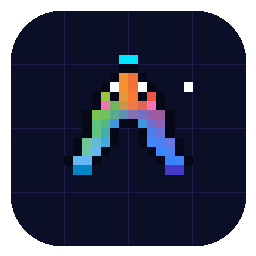
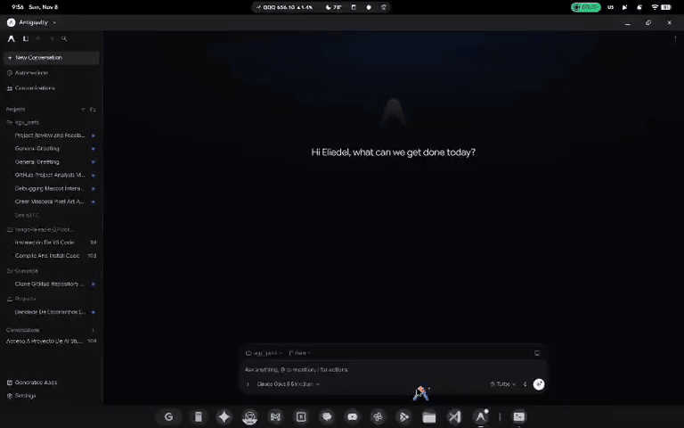
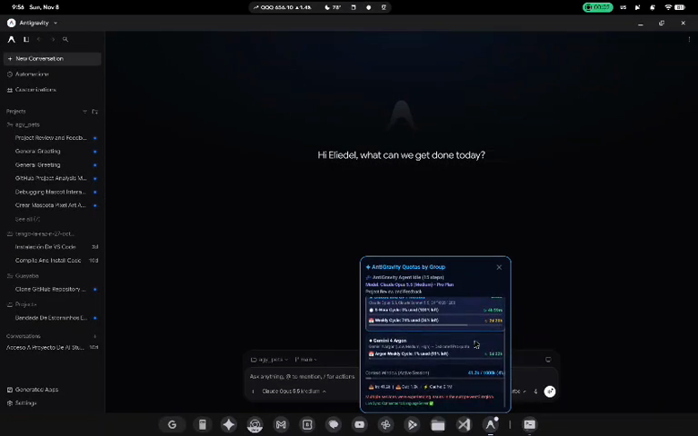
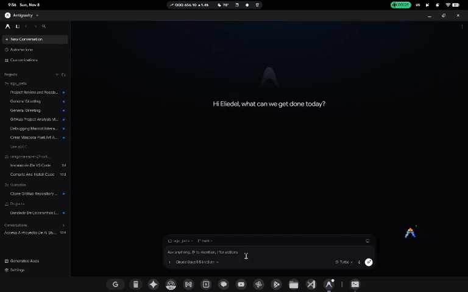
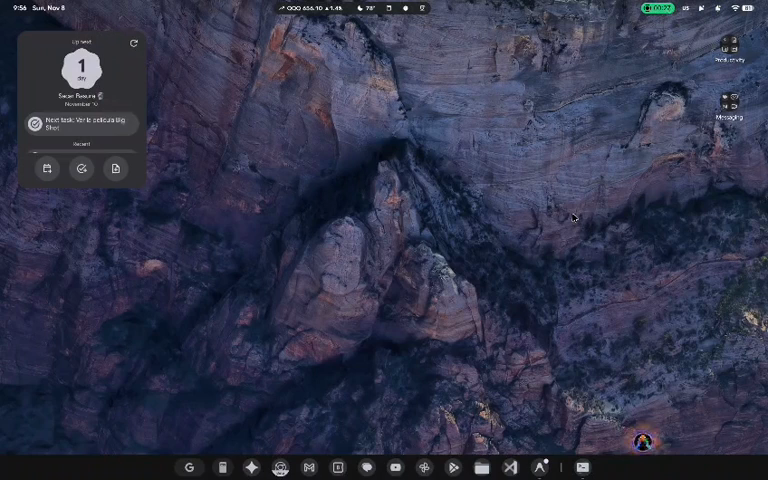

# ✦ AntiGravity Pets & Quotas (AgyPets)

> **Official Pixel Art Desktop Mascot & Live AI Quota Companion for GoogleBook OS (Android Laptop)**  
> Inspired by classic desktop Shimeji companions and [`clawd-usage-gnome`](https://github.com/Oft3r/clawd-usage-gnome).

<p align="center">
  
</p>

---

## 📸 Live Demo & Screenshots

### 🎬 Full Interactive Walkthrough


> 💡 *Also available in [high-efficiency MP4 video (`docs/media/demo.mp4`)](docs/media/demo.mp4).*

| Anchored Quota HUD & Context Window | Zero-Gravity Toss & Working Aura | Black Hole Spaghettification |
|:---:|:---:|:---:|
|  |  |  |
| *Real-time breakdown of Gemini, Argon & Claude/GPT pools* | *50-pixel mascot floating with pulsing cyan/violet beacons* | *Cosmic accretion disk & tidal spaghettification on window exit/enter* |

---

## 🌟 Overview

**AntiGravity Pets (`AgyPets`)** is an interactive desktop companion engineered specifically for GoogleBook OS (Android Laptop) and the Google AntiGravity IDE environment.

It brings a retro, pixel-perfect incarnation of the official **AntiGravity "A" logo** to life on your desktop: walking along the bottom taskbar, floating gently with zero-gravity orbital physics, reacting to user touches and drags, and visually reflecting real-time AI activity and quota consumption.

---

## ✨ Key Features

### 1. Official AntiGravity Pixel Art Mascot
- **50 Authentic Pixels**: Handcrafted, math-aligned recreation of the official multicolor AntiGravity "A" glyph (amber apex, lime/emerald shoulders, indigo crossbar, sapphire prongs).
- **Expressive Emotions**:
  - **Walking & Bobbing**: Cycles through custom footstep frames along the bottom shelf.
  - **Working Aura**: Emits pulsing cyan (`#00E5FF`) and violet (`#818CF8`) energy beacons when the AntiGravity AI agent is actively executing commands or generating code.
  - **Sweat Beads**: Visually perspires when context window usage or model quota surpasses 80%.
  - **Toss & Float**: Supports zero-gravity physics when thrown across the screen, gently drifting and kicking its feet without clipping into window boundaries.

### 2. Live Quotas & Model Groups Tracking
Antigravity models do not share a single reset pool; they are grouped into **3 distinct quota tiers**. AgyPets tracks and breaks down all of them in real-time:
1. **Gemini Models** (Gemini 2.5 Flash, Gemini 2.5 Pro, Gemini Thinking)
2. **Gemini 4 Argon** (Specialized reasoning models)
3. **Claude & GPT Models** (Claude 3.5 Sonnet, Claude Opus 5.5, GPT-4o, etc.)

For every group, AgyPets tracks:
- **Rolling 5-Hour Window**: Remaining percentage and dynamic countdown timer (`Xh Ym`).
- **Weekly Reset Quota**: Remaining percentage and weekly reset countdown (`Xd Xh`).
- **Active Model Detection**: Automatically identifies which model you currently have selected in `antigravity_state.pbtxt`.

### 3. Context Window & Active Session Inspection
- Tracks real conversation tokens from active `transcript.jsonl` and `conversation_summaries.db`:
  - **Input Tokens** (Prompt)
  - **Output Tokens** (Completion)
  - **Cache Read Tokens** (Context cache hits)
  - **Active Context Window Percentage**: Progress bar with smart thresholds (200k, 1M, 2M limits).

### 4. Anchored Expandable HUD & Floating Status Pill
- **Floating Status Pill**: A sleek capsule pinned directly above the mascot showing the active model group and remaining percentage (e.g. `[⚡ Argon 18% (4h 12m)]`).
- **Dynamic Anchored HUD**: Tapping the mascot or pill opens a comprehensive dashboard that computes its coordinates on the fly to **anchor smoothly right above the mascot's live $(X, Y)$ position**.

### 5. Black Hole Spaghettification Transition 🕳️
- **Auto-Show / Auto-Hide**: The mascot automatically appears when the `com.google.android.apps.antigravity` application is open on screen, and disappears when minimized, closed, or force-stopped.
- **Cosmic Spaghettification**:
  - **Collapse (Exit)**: When Antigravity closes, a spinning black hole opens with gravitational lensing, a tilting accretion disk, and a photon ring. Every single pixel of the mascot is stretched along tidal force vectors into cosmic noodles and swallowed into the singularity before colapsing with a cyan flash.
  - **Emerge (Enter)**: When Antigravity opens, the singularity ejects the spaghettified matter in reverse, reassembling the pixels into the desktop companion as it resumes walking.

### 6. System Boot Integration
- Automatically boots on startup via `RECEIVE_BOOT_COMPLETED`, `QUICKBOOT_POWERON`, and `MY_PACKAGE_REPLACED`.

---

## 🏗️ Architecture & How It Works

```
┌────────────────────────────────────────────────────────────────────────┐
│                          GOOGLEBOOK OS (HOST)                          │
│                                                                        │
│   ┌──────────────────────────┐         ┌───────────────────────────┐   │
│   │   com.google.android.    │         │     com.droid.agypets     │   │
│   │     apps.antigravity     │         │   (FloatingPetService)    │   │
│   └────────────┬─────────────┘         └─────────────▲─────────────┘   │
│                │                                     │                 │
│      Android Multi-Window                            │ Android Overlay │
│      UsageStatsManager Events                        │ WindowManager   │
│                │                                     │                 │
├────────────────┼─────────────────────────────────────┼─────────────────┤
│                ▼                                     │                 │
│   ┌──────────────────────────┐         ┌─────────────┴─────────────┐   │
│   │  Linux VM (Android Term) │         │  HTTP Client / File Sync  │   │
│   │                          │         │  http://127.0.0.1:18765   │   │
│   │   LanguageServerService  │◄────────┤             or            │   │
│   │    ConnectRPC (41555)    │         │    usage_limits.json      │   │
│   │                          │         └─────────────▲─────────────┘   │
│   │   agy-sync-usage.service │                       │                 │
│   │      (sync_usage.py)     │───────────────────────┘                 │
│   └──────────────────────────┘                                         │
└────────────────────────────────────────────────────────────────────────┘
```

### 1. Dual-Environment Host & Linux VM Bridge
- **Android Host**:
  - Runs the Jetpack Compose user interface (`MainActivity`) and background overlay service (`FloatingPetService`).
  - Utilizes `WindowManager.LayoutParams.TYPE_APPLICATION_OVERLAY` for fluid 60 FPS sprite rendering and touch physics.
- **Linux VM**:
  - The Android Terminal environment hosts the Antigravity backend Language Server.
  - `sync_usage.py` runs as a systemd user daemon (`agy-sync-usage.service`), scraping the dynamic `/proc/[0-9]*/environ` to discover the `ANTIGRAVITY_LS_ADDRESS` and `ANTIGRAVITY_CSRF_TOKEN`.
  - Queries `RetrieveUserQuotaSummary` and `GetUserStatus` via local ConnectRPC and serves JSON over HTTP port `18765` as well as caching to `usage_limits.json`.

### 2. Stateful Window Lifecycle Tracking
Android multi-window desktop mode means multiple apps can be on screen simultaneously. Previous implementations failed because background daemons ran 24/7.
`AntigravityDetector` solves this with a **stateful activity-tracking engine**:
- Listens to Android `UsageStatsManager` query events over an incremental time delta.
- Tracks `ACTIVITY_RESUMED` / `ACTIVITY_PAUSED` (visible windows) vs `ACTIVITY_STOPPED` / `ACTIVITY_DESTROYED` (closed or minimized windows).
- Pairs with the VM Language Server tunnel heartbeat (`lsAlive`): if the Antigravity app process is killed or force-stopped, the tunnel collapses within seconds, guaranteeing the mascot hides immediately.

---

## 📁 Repository Structure

```
agy_pets/
├── app/
│   ├── build.gradle.kts           # Android build configuration (SDK 36, Java 17)
│   └── src/main/
│       ├── AndroidManifest.xml    # Permissions: OVERLAY, STORAGE, BOOT, USAGE_STATS
│       ├── kotlin/com/droid/agypets/
│       │   ├── MainActivity.kt    # Jetpack Compose settings & permission coordinator
│       │   ├── data/
│       │   │   ├── AgyUsageModel.kt       # Quota data models, 3 groups & 13 models
│       │   │   ├── AgyUsageRepository.kt  # Dual HTTP / File-based snapshot consumer
│       │   │   └── PetPreferences.kt      # SharedPreferences storage
│       │   ├── engine/
│       │   │   └── PetBehaviorEngine.kt   # Physics, gravity, walking bounds & drag
│       │   ├── receiver/
│       │   │   └── BootReceiver.kt        # Auto-launch service on device boot
│       │   ├── service/
│       │   │   └── FloatingPetService.kt  # Overlay window manager & lifecycle loop
│       │   ├── ui/
│       │   │   ├── main/MainScreen.kt     # English Material 3 dashboard
│       │   │   └── view/
│       │   │       ├── PixelPetView.kt    # 50-pixel Canvas mascot renderer
│       │   │       ├── BlackHoleView.kt   # Cosmic spaghettification shader
│       │   │       ├── AgyStatusPillView.kt # Floating mini status pill
│       │   │       └── AgyUsageHudView.kt # Anchored expandable quota card
│       │   └── util/
│       │       └── AntigravityDetector.kt # UsageStats window tracking engine
│       └── res/                   # Drawables, mipmaps, and themes
├── daemon/
│   ├── sync_usage.py              # ConnectRPC client & HTTP heartbeat daemon
│   ├── agy-sync-usage.service     # Systemd user service unit
│   └── install.sh                 # 1-click daemon setup script
├── docs/
│   └── media/                     # Demo GIF, MP4 walkthrough & feature screenshots
├── keystore/
│   └── release.jks                # Release signing certificate
└── build.gradle.kts               # Top-level Gradle configuration
```

---

## 🚀 Setup & Installation

### 1. Build the APK
From the Linux VM or development terminal:
```bash
./gradlew assembleRelease
```
The signed APK will be output to:
```
app/build/outputs/apk/release/agypets-release.apk
```

### 2. Install the Background Daemon
To enable real-time quota synchronization and the process tunnel heartbeat:
```bash
chmod +x daemon/install.sh
./daemon/install.sh
```

### 3. Grant Required Android Permissions
When you open **AgyPets** for the first time, grant the requested permissions:
1. **Screen Overlay Permission** (`Display over other apps`): Required to render the mascot on your desktop.
2. **Usage Access** (`Package Usage Stats`): Required for instantaneous auto-show / auto-hide when switching in and out of Antigravity.
3. **All Files Access** (`MANAGE_EXTERNAL_STORAGE`): Allows reading local session summaries and transcripts.

---

## 🎮 Mascot Controls & Interaction

| Interaction | Action |
|---|---|
| **Click / Tap Mascot** | Pokes the pet and toggles the anchored Quota HUD. |
| **Click / Tap Pill** | Toggles the anchored Quota HUD directly. |
| **Drag & Toss** | Pick up the mascot and fling it across your screen with zero-gravity momentum. |
| **Notification "Hide"** | Instantly dismisses the mascot from the screen without disabling the service. |
| **Antigravity Focus** | Mascot automatically enters via black hole when Antigravity opens and exits when closed. |

---

## 📜 License

Created with ❤️ for the Google AntiGravity & GoogleBook OS Community.  
Proprietary & Private — All rights reserved by [@Oft3r](https://github.com/Oft3r).
